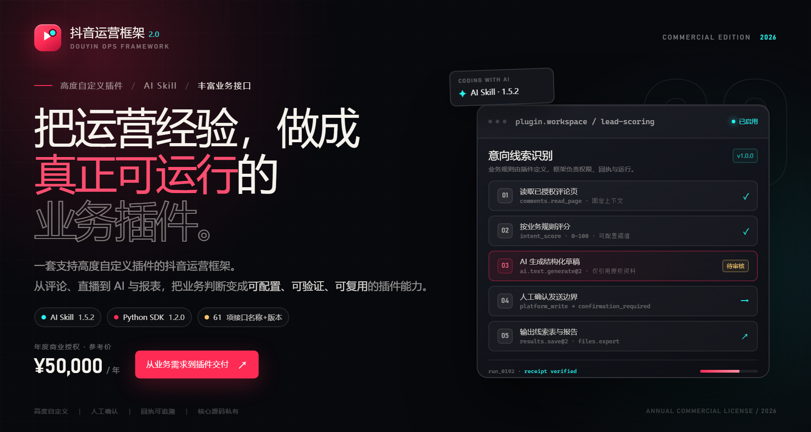
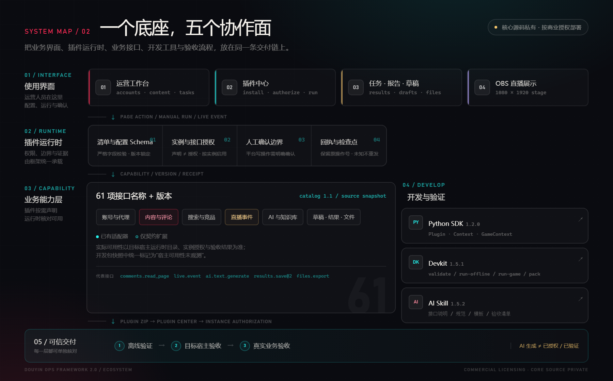
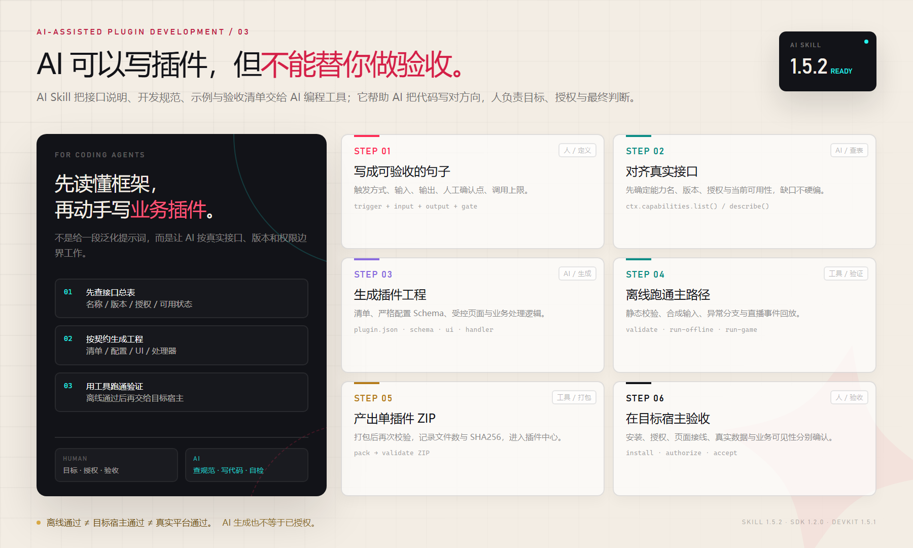
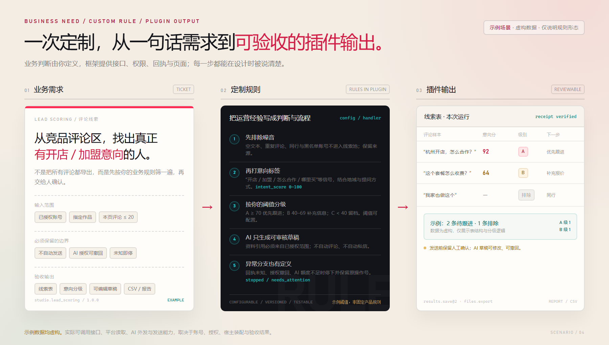
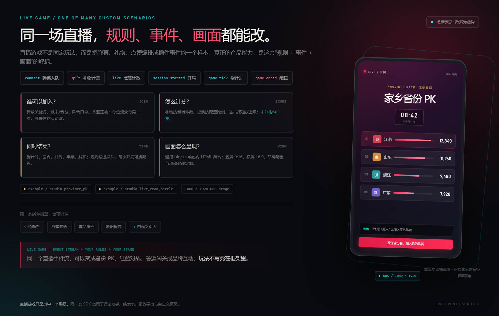
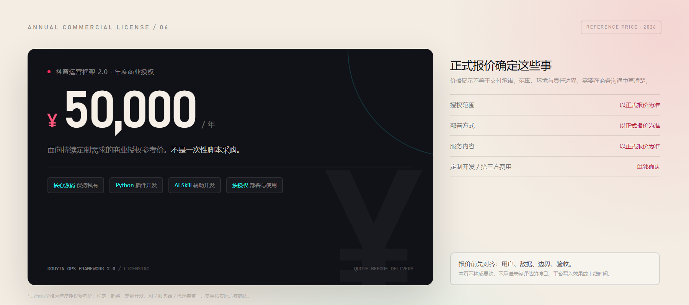
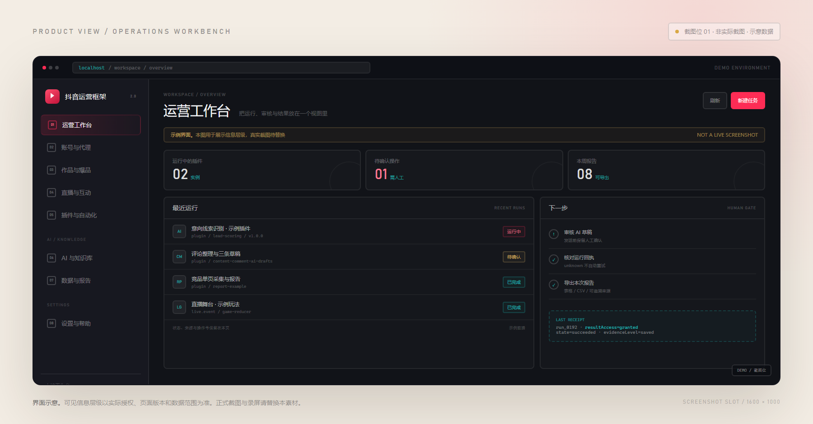
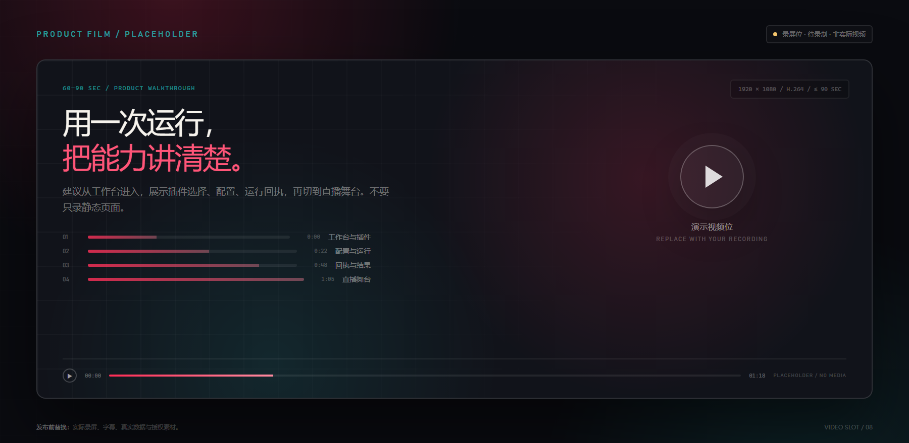

<a id="top"></a>

<p align="center">
  
</p>

<h1 align="center">抖音运营框架 2.0</h1>

<p align="center">
  <strong>一套支持高度自定义插件的抖音运营框架。</strong><br />
  把运营经验写成插件，把接口、AI、验证与交付放进同一条链路。
</p>

<p align="center">
  <code>高度自定义插件</code> · <code>丰富业务接口</code> · <code>Python SDK</code> · <code>AI Skill</code>
</p>

<p align="center">
  <code>商业授权</code> · <code>核心源码私有</code> · <code>¥50,000 / 年</code>
</p>

<p align="center">
  <a href="https://wetiao.github.io/douyin-ops-framework-2.0-showcase/preview/"><strong>在线产品页 →</strong></a> ·
  <a href="#contact"><strong>预约演示 / 获取报价</strong></a>
</p>

<p align="center">
  <a href="#why"><strong>产品定位</strong></a> ·
  <a href="#system"><strong>系统组成</strong></a> ·
  <a href="#example"><strong>定制示例</strong></a> ·
  <a href="#scenarios"><strong>业务场景</strong></a> ·
  <a href="#customers"><strong>适用客户</strong></a> ·
  <a href="#pricing"><strong>年度报价</strong></a> ·
  <a href="#contact"><strong>商务咨询</strong></a>
</p>

---

> **一句话理解**：如果你的团队需要持续为自己的抖音业务做定制工具，这套框架提供“运营工作台 + 业务接口 + 插件运行时 + Python SDK + AI 开发 Skill”的底座，让每次定制沉淀为可复用插件，而不是从零写脚本。
>
> **它不是什么**：不是承诺涨粉、获客或 GMV 的营销软件，不是绕过平台限制的自动群发工具，也不是“AI 生成即上线”的黑盒。

## 一眼看懂

| 关键项 | 说明 |
| --- | --- |
| 产品定位 | 支持高度自定义插件的抖音运营框架 |
| 核心卖点 | 抖音运营框架、AI Skill、高度自定义插件、丰富业务接口 |
| 开发方式 | Python 插件；Python SDK **1.2.0**；开发包 **1.5.1**；AI Skill **1.5.2** |
| 能力底座 | 账号与代理、内容与评论、搜索与竞品、直播事件、AI 与知识库、数据与草稿、结果与文件等 |
| 接口范围 | 能力目录 **61 项名称 + 版本**；包含已有适配器与仅契约扩展，实际可用性以目标宿主和授权为准 |
| 可定制范围 | 业务规则、判断条件、处理流程、接口组合、插件配置、展示页面 |
| 授权方式 | 年度商业授权；核心源码保持私有 |
| 参考年费 | **¥50,000 / 年**；具体授权范围、部署方式与服务内容以正式报价为准 |

<a id="why"></a>

## 01 · 为什么需要一套“框架”，而不是更多脚本

抖音运营里的重复工作，通常不是缺一个按钮，而是缺一条能反复交付的链路：

- 每做一个工具，都要重新处理账号、内容、评论、直播、AI、报告和文件导出；
- 运营经验散落在文档、群聊和个人习惯里，换一个人就难以复用；
- “自动执行”听起来很快，但授权、回执、人工确认和异常处理，才是能不能交给客户使用的关键。

抖音运营框架 2.0 把这些问题收进同一套底座：

**把重复的底层能力封装起来，把真正属于你的业务判断留给插件。**

| 传统做法 | 使用框架后 |
| --- | --- |
| 每个需求单独写脚本、单独接接口 | 复用已登记的业务能力与插件运行时 |
| 规则散落在代码里，难解释、难验收 | 规则进入插件，配置、版本与处理流程可核对 |
| 自动执行缺少边界，难以交给客户 | 权限、人工确认、操作回执与检查点由框架承载 |
| 一次交付结束，下一次又从零开始 | 插件可继续修改、复用和扩展，沉淀为团队资产 |

### 可以自定义什么

| 定制维度 | 你可以定义的内容 | 最终形成 |
| --- | --- | --- |
| 业务规则 | 谁算高意向、什么情况优先、何时停止、如何分组 | 可执行的判断逻辑 |
| 判断条件 | 关键词、地域、账号关系、黑名单、数量、时间窗、阈值 | 可调整的规则参数 |
| 处理流程 | 手动运行、页面动作、串行调用、异常分支、检查点 | 可验收的业务流程 |
| 接口组合 | 评论读取、AI 生成、草稿、结果、文件导出等组合 | 一段完整的插件能力链 |
| 插件配置 | 严格配置 Schema、默认值、必填项、范围限制 | 可配置的运营工具 |
| 展示页面 | 受控声明式页面、通用 `blocks` 视图、自带 HTML 直播舞台 | 工作台页面或 9:16 直播画面 |

> 以上是框架允许的定制面，不代表所有组合都已在每个环境完成验收。实际实现范围、接口可用性、工作量与验收标准，需要在项目中确认。

<a id="system"></a>

## 02 · 从工作台到验收，五个协作面

<p align="center">
  <a href="assets/system-map.png">
    
  </a>
</p>

<p align="center"><sub>系统关系示意 · 能力数量与版本以当前开发包和运行时目录为准 · 点击查看大图</sub></p>

### 五个部分如何协作

**① 使用界面**
运营工作台、插件中心、任务与结果、草稿与报告、OBS 直播展示页。业务人员在这里配置、运行、审核和查看结果。

**② 插件运行时**
插件清单、严格配置 Schema、实例授权、人工确认边界、操作回执与检查点。框架负责“什么能执行、执行到哪一步、结果如何保留”。

**③ 业务能力层**
能力目录当前登记 **61 项名称 + 版本**，覆盖账号、内容、评论、搜索、竞品、直播、AI、知识库、草稿、结果、文件等方向。

> **口径说明**：61 项是“名称 + 版本”的条目数，不等于 61 个已验收插件，也不等于全部能力在任意宿主都可用。目录中同时存在已有适配器、仅契约扩展和已登记但需人工确认的条目；运行时以 `ctx.capabilities.list()` / `describe()`、实例授权和部署状态为准。

**④ Python SDK 与开发工具**
Python SDK **1.2.0** 提供插件、上下文、直播游戏上下文、事件、回执、检查点和错误类型。开发包 **1.5.1** 提供初始化、静态校验、离线运行、直播事件回放和单插件打包。

**⑤ AI Skill**
AI Skill **1.5.2** 向 AI 编程工具提供接口说明、开发规范、事件与页面契约、模板和验收清单，让 AI 先理解框架，再生成可验证的插件工程。

```text
业务需求
   ↓
AI Skill 查接口 / 读规范 / 选模板
   ↓
Python SDK 编写插件
   ↓
Devkit 静态校验 + 离线运行 / 直播回放
   ↓
单插件 ZIP → 插件中心 → 实例授权 → 工作台 / OBS
   ↓
目标宿主验收 → 真实业务验收
```

> AI Skill 不授予任何运行时权限。AI 生成的代码仍需人工审核、工具校验和目标环境验收。

## 03 · AI Skill：让 AI 编程工具先懂框架，再写插件

<p align="center">
  <a href="assets/ai-loop.png">
    
  </a>
</p>

<p align="center"><sub>AI 辅助插件开发闭环 · 人负责目标、授权与验收 · 点击查看大图</sub></p>

AI Skill **1.5.2** 不是一段泛化的“帮我写抖音插件”提示词，而是一套面向框架的开发资料：

- **先查接口**：接口名称、版本、授权要求、可用状态和能力调用规则；
- **再写工程**：插件清单、配置 Schema、受控 UI、事件处理与检查点；
- **然后验证**：`validate`、`run-offline`、`run-game` 与 `pack`；
- **最后交付**：给出未验证项和验收边界，而不是把离线结果当成上线结果。

它兼容以 `SKILL.md`、`AGENTS.md`、`PROMPT.md` 为入口的 AI 编程工具使用方式，包括 Codex、Cursor、Claude Skills 等入口；实际体验以对应工具的支持范围为准。

### 从需求到 ZIP，固定成六步

| 步骤 | 谁来做 | 产物 |
| --- | --- | --- |
| 1. 写成可验收的句子 | 业务 + 技术 | 触发方式、输入、输出、人工确认点、调用上限 |
| 2. 查接口总表 | AI + 人核对 | 能力名称、版本、授权、当前可用状态 |
| 3. 生成插件工程 | AI + 人 | 清单、配置、页面、处理器 |
| 4. 离线验证 | 工具 + 人 | 静态校验、主路径、异常分支、直播回放 |
| 5. 打包单插件 ZIP | 工具 | 可导入插件中心的安装包与校验记录 |
| 6. 目标宿主验收 | 人 | 安装、授权、页面、数据、真实业务条件 |

```bash
python tools/devkit.py doctor
python tools/devkit.py validate work/my-plugin
python tools/devkit.py run-offline work/my-plugin
python tools/devkit.py pack work/my-plugin --output dist/my-plugin-1.0.0.zip
```

> 以上命令只做本地检查，不启动正式后台、不申请扫码、不访问真实平台。正式安装、授权与真实业务效果必须在目标宿主单独验收。

<a id="example"></a>

## 04 · 一个完整示例：业务需求 → 定制规则 → 插件输出

<p align="center">
  <a href="assets/example-workflow.png">
    
  </a>
</p>

<p align="center"><sub>示例场景 · 数据为虚构 · 仅用于说明规则如何落到插件 · 点击查看大图</sub></p>

### 需求

一个品牌代运营团队，希望在已获授权的竞品作品评论区里，找到真正有开店、加盟或合作意向的人，减少无效跟进。

### 输入与边界

- 已授权账号、指定作品和固定页面上下文；
- 本页评论，示例上限 20 条；
- 不自动发送评论或私信；
- AI 只生成可编辑草稿；
- 回执未知、授权撤回或额度不足时停止，并保留原操作号。

### 规则

| 规则层 | 示例定义 | 形成的结果 |
| --- | --- | --- |
| 清洗 | 空文本、重复评论、黑名单、同行账号先排除 | 干净的候选池 |
| 识别 | “开店 / 加盟 / 怎么合作 / 哪里买”等意向信号，结合地域和提问方式 | 意图标签与证据 |
| 分级 | `intent_score` 0–100；示例 A ≥ 70、B 40–69、C 低于 40 | A / B / C 线索分层 |
| AI 草稿 | 只基于已授权资料生成结构化草稿，不自动发送 | 可编辑的沟通建议 |
| 异常处理 | 状态未知、结果撤权、AI 额度不足时不继续 | 保留原操作号，等待人工核对 |

### 预期输出

- 一张带来源、分数、级别和下一步建议的线索表；
- 可人工修改的沟通草稿；
- 一份运行报告；
- 可导出的 CSV / 表格文件。

> **示例数据均虚构**。示例中的插件名称与 A/B/C 分级、阈值、分数仅用于说明规则形态，不对应已发行的标准产品，也不代表任何客户效果。实际可调用的接口、AI 外发、平台读取与发送能力，取决于账号、授权、宿主装配和验收结果。

### 这个示例体现了什么

- **规则属于业务方**：谁算高意向、阈值多少、何时停止，都可以写进插件；
- **AI 只做辅助**：生成草稿，不替代人工确认，不自动触达；
- **结果可追溯**：来源、分数、回执与异常状态都保留；
- **插件可继续迭代**：新增关键词、调整分级、换一种输出页面，不需要推翻底座。

<a id="scenarios"></a>

## 05 · 主要业务场景

| 场景方向 | 可用底座 → 典型定制输出 |
| --- | --- |
| **客户截流与意向识别** | 对已授权的内容、评论和页面上下文做规则筛选与意向分层，输出线索表、优先级和跟进建议；不绕过平台限制。 |
| **AI 回复助手与客户沟通** | 结合评论、问题、知识库和 AI 用途生成可审核草稿；发送前保留人工确认，适合客服、售前和私信辅助流程。 |
| **热点分析与竞品观察** | 复用搜索、竞品保存和内容读取等接口，定制主题归纳、作品结构、评论关注点和选题报告。 |
| **直播游戏与互动活动** | 消费弹幕、礼物、点赞等直播事件，按你的规则计分、分组、倒计时和结算，输出工作台画面或 1080×1920 直播舞台。 |
| **数据整理与业务报告** | 将运行结果保存为文本、表格或报告，按需导出 CSV，保留来源和回执，适合周报、复盘和交付材料。 |
| **团队页面与交付流程** | 用受控配置页、`blocks` 视图或包内 HTML 页面，把内部工具包装成可配置、可授权的运营页面。 |

> 这些是已经具备底座能力或可基于接口定制的方向，不是六个开箱即用的套餐。每个方向都要核对账号条件、数据权限、宿主装配和验收范围。

## 06 · 直播游戏：规则、事件、画面都能定制

<p align="center">
  <a href="assets/live-game.png">
    
  </a>
</p>

<p align="center"><sub>界面示意 · 数据为虚构 · 非真实直播截图 · 点击查看大图</sub></p>

直播游戏是框架能力的一个集中展示，也是理解“高度自定义”的最好入口：

- **事件**：`comment`、`gift`、`like`、`session.started`、`game.tick`、`game.ended`；
- **规则**：谁可以加入、什么礼物算分、点赞如何换算、何时结束、并列与零票怎么处理；
- **画面**：通用 `blocks` 视图，或插件包内自己的 HTML/CSS/JS 舞台；
- **场景**：工作台预览、1080×1920 竖屏 OBS 展示、真实直播间互动。

### 同一个事件流，可以长出不同玩法

| 可定制层 | 可以定义什么 |
| --- | --- |
| 加入规则 | 省份 / 城市关键词、阵营口令、答题正确、指定用户行为 |
| 计分规则 | 礼物新增件数、点赞换算、连击、权重、单人/阵营上限 |
| 回合规则 | 开局、倒计时、暂停、结算、并列、下一局 |
| 舞台画面 | 榜单、赛道、比分、动效、品牌配色、横屏或竖屏 |
| 安全边界 | 未知礼物不猜、重复帧不动作、异常不继续、状态封顶 |

现有示例包括“家乡省份 PK”和“红蓝计分测试”。它们证明的是插件模型、事件处理和舞台呈现方式；真实直播的到达、计分、延迟与第三方可见性，仍需在目标环境和真实场次单独验收。

> 直播游戏只是其中一种插件场景。同一套 SDK 和运行时，也可以承载评论助手、线索表、报告导出和自定义页面。

<a id="customers"></a>

## 07 · 适用客户与购买价值

### 这套框架更适合谁

| 客户类型 | 持续需求 | 可沉淀的插件资产 |
| --- | --- | --- |
| **品牌商家** | 品牌话术、活动规则、评论筛选、客户沟通、经营报告 | 自己的意向分级、回复草稿、活动互动和报告页面 |
| **代运营机构 / 营销服务商** | 多账号、多客户、多轮活动与交付报告 | 可复用的项目模板、规则组件、验收流程和报告口径 |
| **MCN / 内容团队** | 热点研究、竞品观察、选题分析、直播互动 | 内容研究、评论洞察、直播游戏与栏目化页面 |
| **技术团队 / 工作室** | 为客户交付定制工具，同时控制权限和风险 | 基于统一 SDK 的插件产品、配置页和交付资产 |
| **有内部开发能力的品牌团队** | 把内部 SOP 变成可执行的运营工具 | 可版本化、可复用、可继续扩展的内部系统 |

### ¥50,000 / 年，买的是持续定制能力，不是一次性脚本

对于有持续需求的团队，年度授权的价值不在于“多一个功能”，而在于：

- **不用每次都重搭底座**：账号、内容、评论、直播、AI、报告和导出等基础能力可以复用；
- **运营经验可以变成资产**：判断条件、流程和输出可以沉淀在插件里，继续修改、复用和扩展；
- **交付更可控**：权限、人工确认、回执与检查点，让工具能进入真实业务，而不只是演示；
- **团队可以持续迭代**：已有插件不必推倒重来，新增场景可以复用同一套工程与验收方法。

从价格结构看，**¥50,000 / 年** 更适合有多个持续场景、预计一年内多次迭代、并且具备技术/服务商协作能力的组织。如果全年只有一个简单的一次性需求，单独定制或采购轻量工具通常更合适。

**它更适合：** 有明确运营方法、需要多个定制工具、愿意投入技术和运营协作、重视权限和交付边界的团队。

**它不太适合：** 只需要一次性采集脚本、期待买来即自动获客、没有验收接口人、或希望绕过平台规则批量触达的团队。

> 年度授权不等于无限定制。具体授权范围、部署方式、服务内容、定制开发工作量和排期，以正式报价与合同为准。本页不承诺固定的开发时长或效果数字。

## 08 · 产品组成

| 组成部分 | 作用 |
| --- | --- |
| **运营工作台** | 账号与代理、内容与评论、直播互动、插件中心、AI 与知识库、任务与报告等运营入口 |
| **业务能力层** | 目录登记 **61 项名称 + 版本**；提供账号、内容、评论、搜索、竞品、直播、AI、知识库、草稿、结果、文件等方向的能力契约 |
| **插件运行时** | 插件清单、配置 Schema、实例授权、人工确认、操作回执、检查点与异常边界 |
| **Python SDK 1.2.0** | 普通插件与直播游戏插件所需的公开 SDK 入口、上下文、事件、回执和检查点 |
| **Devkit 1.5.1** | `doctor`、`init`、`validate`、`run-offline`、`run-game`、`pack` 等开发与离线验证工具 |
| **AI Skill 1.5.2** | 面向 AI 编程工具的接口说明、开发规范、模板、示例和验收清单 |
| **插件模板与示例** | 最小插件、串行流程、评论助手、直播游戏、表格报告等可运行样例 |
| **交付与验收** | 离线验证 → 目标宿主验收 → 真实业务验收，按项目记录边界和未验证项 |

### 已有能力、可定制方向与需要单独开启的部分

**已具备底座或示例**
账号与代理管理、作品与评论读取（受授权和页面上下文约束）、直播事件处理、AI 模型配置、知识库检索、草稿与结果保存、表格与 CSV 导出、插件安装与授权、OBS 展示。

**通常需要定制开发**
意向识别与线索分层、客户沟通草稿流程、竞品/热点专题分析、直播玩法和舞台、业务看板与专属报告。它们不是固定的“功能按钮”，而是基于接口和业务规则实现的插件。

**需要按环境开启并单独验收**
真实平台读取与写入、真实 AI 文本调用、真实直播采集、第三方连接器、多账号与代理条件。平台写操作在插件通道需要人工确认；AI 文本执行默认关闭，需配置模型、用途、外发授权、额度和运行开关。

> 能力目录中部分条目为 **仅契约扩展（contract_only）**，调用会明确返回不可用，不能把它们当作已交付功能。请以目标宿主运行时的能力目录、实例授权和验收记录为准。

<a id="pricing"></a>

## 09 · 年度报价

<p align="center">
  
</p>

<p align="center">
  <strong>年度商业授权参考价：¥50,000 / 年</strong><br />
  <sub>具体授权范围、部署方式、服务内容与税费以正式报价和合同为准。</sub>
</p>

| 报价相关项 | 当前口径 |
| --- | --- |
| 授权方式 | 年度商业授权，核心源码保持私有 |
| 授权范围 | 以正式报价与合同为准，不在展示页默认扩大使用范围 |
| 部署方式 | 以正式报价与项目环境评估为准 |
| 服务内容 | 商务咨询、需求评估、定制开发和验收服务按正式报价确认 |
| 定制开发 | 不在年度参考价中默认包含无限定制；按需求范围另行确认 |
| 第三方费用 | AI 调用、服务器、代理、存储等按实际方案与用量另行确认 |
| 公开仓库内容 | 仅产品展示、图片素材和说明，不包含核心源码，也不构成开源许可 |

### 报价前建议先对齐

1. **业务目标**：要减少哪段重复工作，结果交给谁使用；
2. **账号与数据**：哪些账号、作品、评论、直播或知识库在授权范围内；
3. **接口条件**：需要哪些能力，当前宿主是否已装配、是否需要新增适配；
4. **人工确认点**：哪些动作必须由人审核，哪些结果必须保留原操作号；
5. **验收标准**：离线通过、目标宿主通过、真实业务通过分别如何判定。

## 10 · 交付与验收，不把“演示通过”说成“业务通过”

这是框架交付中最重要的边界之一：

| 验证层级 | 验证什么 | 不能证明什么 |
| --- | --- | --- |
| **离线验证** | 清单、配置、代码结构、主路径、异常分支、直播事件回放 | 真实账号、真实平台、真实 AI、宿主持久化与第三方可见性 |
| **目标宿主验收** | 安装、实例授权、页面接线、能力目录、保存数据与页面行为 | 真实直播到达、真实发送效果或客户业务结果 |
| **真实业务验收** | 真实账号/内容/直播/AI/写操作条件下的完整链路与可见结果 | 其他账号、其他环境或长期稳定性 |

本页不承诺固定开发时长，也不把离线通过、接口返回、任务受理或页面显示当成最终成功。具体验收项、未验证项和交付记录，按项目约定确认。

## 11 · 界面与素材位

<p align="center">
  <a href="assets/workbench-placeholder.png">
    
  </a>
</p>

<p align="center"><sub>截图位 01 · 运营工作台 · 当前为界面示意，正式截图待替换 · 点击查看大图</sub></p>

<p align="center">
  <a href="assets/video-placeholder.png">
    
  </a>
</p>

<p align="center"><sub>录屏位 · 建议 60–90 秒 · 当前为占位封面，不含实际视频 · 点击查看大图</sub></p>

| 素材 | 当前状态 | 发布前建议 |
| --- | --- | --- |
| 运营工作台截图 | 界面示意，非实际截图 | 替换为真实授权环境截图，移除示意标记 |
| 插件配置 / 运行回执截图 | 待补 | 展示配置、权限、回执与人工确认点 |
| 直播舞台截图 | 示意，数据虚构 | 替换为真实测试场或脱敏舞台截图 |
| 产品演示录屏 | 占位封面 | 60–90 秒，按“工作台 → 配置 → 运行 → 回执 → 舞台”录制 |
| 客户案例 / 效果数据 | 未展示 | 仅在客户授权、数据可核验后补充 |
| 联系方式 / 二维码 | QQ 已配置；微信 / 二维码待补 | 发布前补齐其他渠道 |

> 本页不展示未经授权的客户名称、Logo、案例、效果数字、开发时长或服务承诺。正式展示素材应以客户授权和可核验材料为前提。

## 12 · 常见问题

<details>
<summary><strong>这是开源项目吗？</strong></summary>

不是。这个页面用于商业产品展示和商务沟通，核心源码保持私有，不附带开源许可证。任何复制、部署、二次开发或商业分发，都需要取得书面授权。

</details>

<details>
<summary><strong>¥50,000 / 年包含哪些内容？</strong></summary>

这是年度商业授权的参考价，不代表固定套餐或无限定制。授权范围、部署方式、服务内容、定制开发、税费和第三方费用，以正式报价与合同为准。建议先完成需求与接口评估，再确认报价。

</details>

<details>
<summary><strong>购买后就能直接使用所有功能吗？</strong></summary>

不能这样理解。框架提供底座、接口、开发工具和示例，具体业务通常需要按你的账号、数据权限、页面和验收标准定制插件。真实平台读取、AI 调用和平台写操作还需要单独开启与验收。

</details>

<details>
<summary><strong>AI 会自动回复评论或私信吗？</strong></summary>

AI 能力用于生成可审核的草稿，不替代人工确认。平台写操作在插件通道需要人工确认，AI 文本执行也默认关闭并按用途授权。产品定位不是“绕过平台限制的自动群发工具”。

</details>

<details>
<summary><strong>没有技术团队，能用 AI Skill 直接做插件吗？</strong></summary>

AI Skill 能显著降低“查接口、写工程、跑验证”的门槛，但仍需要有人定义业务目标、确认授权、审核代码和完成目标环境验收。更现实的组合是运营负责人 + 技术/服务商协作；AI 负责加速，不负责替你承担上线责任。

</details>

<details>
<summary><strong>可以部署在自己的服务器吗？</strong></summary>

部署方式需要结合你的环境、授权范围和安全要求评估，具体以正式报价与交付方案为准。本页不默认承诺任意部署形态。

</details>

<details>
<summary><strong>能服务多个客户或多个账号吗？</strong></summary>

框架可以承载多项目、多插件的开发与复用，但账号、数据和使用范围必须落在授权边界内。是否支持多客户交付、并发规模、代理与账号条件，需要按项目评估，不能由本页推定。

</details>

<details>
<summary><strong>有客户案例、效果数据或交付周期吗？</strong></summary>

本页不展示未经授权的客户案例、效果数字、固定开发时长或服务承诺。需要相关材料时，可在获得客户许可并提供可核验依据后另行沟通。当前可核验的是产品机制、版本和开发包中的能力边界。

</details>

<a id="contact"></a>

## 13 · 商务咨询

如果你正在评估以下事情，欢迎带着具体需求来沟通：

- 想把一套运营 SOP 做成可持续迭代的插件；
- 已经有抖音账号、内容、直播或客服流程，希望补齐工具链；
- 需要为客户交付定制工具，同时保留权限、回执和验收边界；
- 想评估 AI Skill、Python SDK 和现有接口能否支撑你的场景。

> **商务咨询**
>
> QQ：`1718190184`  
> 微信：待补充  
> 预约演示：待补充
>
> <sub>QQ 为当前联系入口；微信、二维码与真实截图待补充。</sub>

<p align="center">
  <a href="#top"><strong>回到顶部 ↑</strong></a>
</p>

---

<a id="facts"></a>

## 事实与展示口径

- **版本依据**：Python SDK **1.2.0**、开发包 **1.5.1**、AI Skill **1.5.2**；能力目录 **1.1**。
- **在线产品页**：[wetiao.github.io/douyin-ops-framework-2.0-showcase](https://wetiao.github.io/douyin-ops-framework-2.0-showcase/preview/)。
- **接口数量口径**：**61 项名称 + 版本**，不是 61 个已验收插件；目录含已有适配器、仅契约扩展和需人工确认的条目，实际可用性以目标宿主运行时目录与实例授权为准。
- **AI 边界**：真实 AI 文本执行默认关闭；需要模型配置、用途绑定、外发授权、额度和运行开关，且单独验收。
- **平台写入边界**：发评论、进房、离房等写操作在插件通道需要人工确认，不作为自动群发能力宣传。
- **直播边界**：模拟回放或离线运行通过，不等于真实直播到达、计分或第三方可见性通过。
- **数据与案例**：本页所有示例评论、分数、名称、榜单和界面数据均为虚构或示意；未展示未经授权的客户案例与效果数据。
- **合规边界**：仅用于合法合规、已获授权的账号与数据；不得绕过平台访问控制、批量骚扰、侵犯隐私或规避平台治理。具体可执行操作以接口接入、授权和验收结果为准。
- **价格边界**：¥50,000 / 年 为年度商业授权参考价；具体授权、部署、服务、税费与第三方费用以正式报价和合同为准。
- **页面性质**：本 README 是商业产品展示页，不是开源许可证、源代码交付承诺或价格要约。

<p align="center">
  <sub>抖音运营框架 2.0 · 商业展示页 · 2026</sub><br />
  <sub>核心源码私有 · 保留所有权利 · 具体合作以正式合同为准</sub>
</p>
